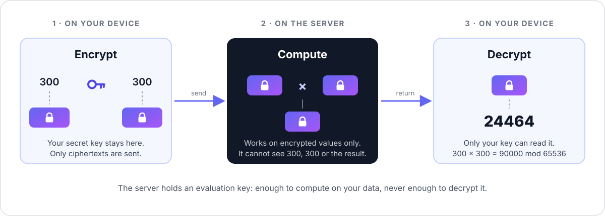
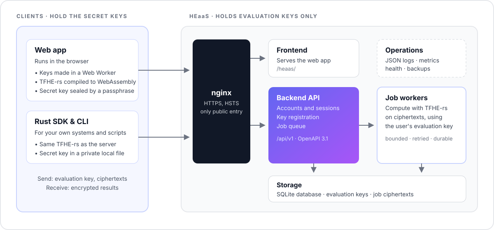

# How the HE Engine works

The Homomorphic Encryption Engine (HE Engine) is a server that you or your
organisation run. Its users send it encrypted numbers, it computes on them without
decrypting them, and only the users can read the results. This page explains what
happens to the data, which keys exist and where they live, and what the server can
and cannot learn. For a hands-on walkthrough see the [user guide](user-guide.md);
for the exact cryptographic parameters see [`parameters.md`](parameters.md).

## Why run it as a server

Homomorphic encryption matters when the machine that computes is not fully trusted
by the people whose data it is: a server shared by a team, an internal service run
by an IT department, or your own instance on a rented cloud machine. The users keep
their secret keys; whoever runs the server (the *operator*) only ever sees ciphertexts.

## The steps

1. **Generate a key pair** on your device. The secret (client) key stays there.
2. **Register the evaluation key** with the server, once, and its public key. The
   server can compute with them but cannot decrypt.
3. **Encrypt your inputs** (optionally with a [proof](#proven-inputs) that they are
   well formed) and submit a job naming the operation and the type.
4. A worker on the server **evaluates the operation on the ciphertexts** with your
   evaluation key and stores an encrypted result.
5. **Fetch the encrypted result** and decrypt it on your device.

## The keys

- **Client key** (~48 KB): generated on your device, used to encrypt and decrypt.
  It is never uploaded. In the dashboard it stays in the browser's IndexedDB,
  encrypted with your passphrase (see [Your key in the browser](#your-key-in-the-browser)).
- **Compressed server key** (~60 MB): an evaluation key derived from the client key.
  It lets the server compute on your ciphertexts but not decrypt them. You register
  it once with `POST /api/v1/keys`; the server checks it against its parameters.
- **Compact public key** (~33 KB): lets anyone encrypt for you, and the server check
  proofs of inputs. It cannot decrypt. You upload it with
  `PUT /api/v1/keys/{id}/public-key`. Each one generated is different, so proofs must
  be made with the one you uploaded; the dashboard and the CLI keep it.
- **Ciphertexts**: from ~17 KB (a boolean) and ~66 KB (8 bits) to ~530 KB (64 bits).
  A proven list holding several inputs is ~20 KB.

Keys made before HE Engine 0.5 lack the public-key parameters. They keep working for
everything except proven inputs.

## What you can compute

| | |
|---|---|
| Types | `u8`, `u16`, `u32`, `u64` and `i8`, `i16`, `i32`, `i64` (two's complement) |
| Arithmetic | `add`, `subtract`, `multiply` (wrapping modulo 2^bits), `min`, `max` |
| Comparisons | `eq`, `ne`, `lt`, `le`, `gt`, `ge`: the result is an encrypted boolean |
| Sums | `sum` of 2 to 16 encrypted inputs |
| Plain operands | any operation but `sum` can take its right-hand side as a plain number (a *scalar*): faster, but the server sees that number |

Each job is one operation; a result can be sent back as an input to the next job.

## Proven inputs

Normally the server can only check that a ciphertext has the right shape. With proven
inputs, the client encrypts the values under the key's public key into one list and
attaches a zero-knowledge proof (TFHE-rs's compact public-key encryption proofs) that
the list is a well-formed encryption of values of the declared type. The server
verifies the proof before computing and refuses the job if it does not verify.

- The proof is bound to the key's id, so a proof made for one key is refused for another.
- It is checked against a CRS (common reference string) that the server generates on
  first start and publishes at `GET /api/v1/he/crs`; its hash is in `/he/params`.
  Whoever generates a CRS is trusted not to have kept a trapdoor: here that is the
  server's operator. See Zama's documentation on zero-knowledge proofs.
- Proving takes about a second on the client; verifying, a fraction of a second up to
  about a second on the server.
- A proof shows that inputs are well formed; it says nothing about whether the server
  then computes correctly (see the limits below). Today only a key's owner can submit
  jobs for it, so proofs mainly guard against corrupted or crafted inputs.

## Architecture

`heaas-core` holds what the backend, the SDK and the CLI must agree on: the TFHE
parameters, the operations and the API types.

## Parameters

| | |
|---|---|
| Scheme | TFHE (CGGI), TFHE-rs **1.8.2** (pinned; clients must use the same release) |
| Configuration | `ConfigBuilder::default()`: TFHE-rs default parameters (`PARAM_MESSAGE_2_CARRY_2_KS_PBS_TUNIFORM_2M128`, failure probability ≤ 2⁻¹²⁸), plus Zama's dedicated compact-public-key parameters (`PARAM_PKE_MESSAGE_2_CARRY_2_KS_PBS_TUNIFORM_2M128`) |
| Types | `FheUint8`–`FheUint64`, `FheInt8`–`FheInt64`, `FheBool` for comparison results |
| Operations | see [What you can compute](#what-you-can-compute) |
| Live values | `GET /api/v1/he/params` |
| Full parameter sheet | [`parameters.md`](parameters.md), generated from `core/src/params.rs` |

Uploaded keys, public keys, ciphertexts and proven lists are deserialized with
TFHE-rs's size-limited, conformance-checked `safe_deserialize_conformant`, so keys
made with other parameters and malformed or foreign ciphertexts are rejected, not
computed on. Results are conformant too: where TFHE-rs would leave part of a result
unencrypted because a plain operand makes it known (`x × 0`, say), the server
re-encrypts it.

## What the server can and cannot learn

The server **cannot** decrypt inputs or results: it only ever holds evaluation keys.

It **does** see metadata: your account, when you submit jobs, which operation and
type each job uses, how many inputs it has, ciphertext sizes and how many jobs you
run. It also sees every plain operand (scalar) you choose to send unencrypted.

Know these limits too:

- **Results are not verifiable.** A dishonest or compromised server could return a
  wrong ciphertext. TFHE alone does not prove that a computation was done correctly.
- **The dashboard trusts its own JavaScript.** The browser code that generates and
  stores your key is served by the operator. If you don't want to trust that code,
  use your own client, such as the [Rust SDK and `heaas` CLI](api.md#rust-sdk-and-heaas-cli).
- **Your passphrase cannot be recovered.** Nobody, including the operator, can reset
  it. Without it (or without a backup file after clearing site data) the key and
  everything encrypted under it is lost.

## Your key in the browser

- **Generated and used in a Web Worker.** Key generation, encryption and decryption run
  in the TFHE worker; the page itself never holds the plaintext client key.
- **Stored sealed.** The worker encrypts the client key with AES-256-GCM under a key
  derived from your passphrase with PBKDF2-HMAC-SHA256 (600,000 iterations, the
  [OWASP recommendation](https://cheatsheetseries.owasp.org/cheatsheets/Password_Storage_Cheat_Sheet.html);
  WebCrypto offers no memory-hard KDF). The SHA-256 of the matching evaluation key is
  authenticated alongside, so a sealed key only opens for its own server key.
- **Unlocked per tab.** After a reload, the key must be unlocked with the passphrase
  again. Signing out stops the worker and forgets the unlocked key.
- **Backups.** *Export backup* on the Keys page downloads the sealed key as a JSON
  file (`heaas-key-….json`); it is useless without the passphrase. *Import backup*
  restores it in another browser after checking the passphrase and that the file
  matches one of your registered evaluation keys.
- Keys stored by earlier versions without a passphrase are sealed the first time they
  are unlocked.

---

## Accounts and sessions

- **Sessions.** Signing in returns a 15-minute access token and sets a refresh token
  as an `HttpOnly; Secure; SameSite=Strict` cookie scoped to `/api/v1/auth`. The
  dashboard keeps the access token in memory only, so page scripts can never read
  a long-lived credential. Every refresh rotates the cookie; replaying an old one
  (more than 10 seconds after it was rotated) revokes that whole session.
- **Cross-site requests.** Cookie-authenticated endpoints also refuse requests whose
  `Origin` is not the app's own (`APP_BASE_URL` or `ALLOWED_ORIGINS`).
- **Email links** (verification, password reset) open frontend pages that carry the
  token in the URL fragment and submit it with a POST. Opening a link (or a mail
  scanner prefetching it) changes nothing. Links work once; verification links
  expire after 24 hours and reset links after 1 hour. Tokens are stored hashed.
- **Google and GitHub sign-in** use the authorization-code flow with PKCE and a
  signed state cookie. Only provider-verified email addresses are accepted (GitHub:
  the verified primary address). The callback hands the browser a one-time code,
  never a token, which the page exchanges with `POST /api/v1/auth/exchange`.
- **Rate limits** are keyed on the client IP (the rightmost `X-Forwarded-For` hop not
  added by a `TRUSTED_PROXIES` address, so clients cannot choose their own) and on
  the target email address for sign-in attempts and outgoing email.
- **Sensitive changes.** Changing or resetting the password signs out every session.
  Deleting an account needs its password, or, for Google/GitHub-only accounts, a
  sign-in within the last 5 minutes.
