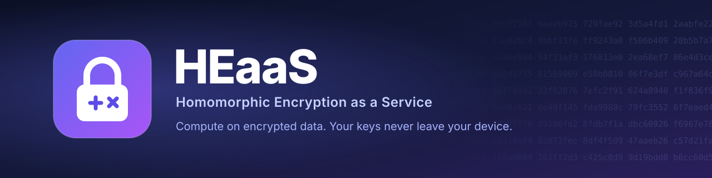
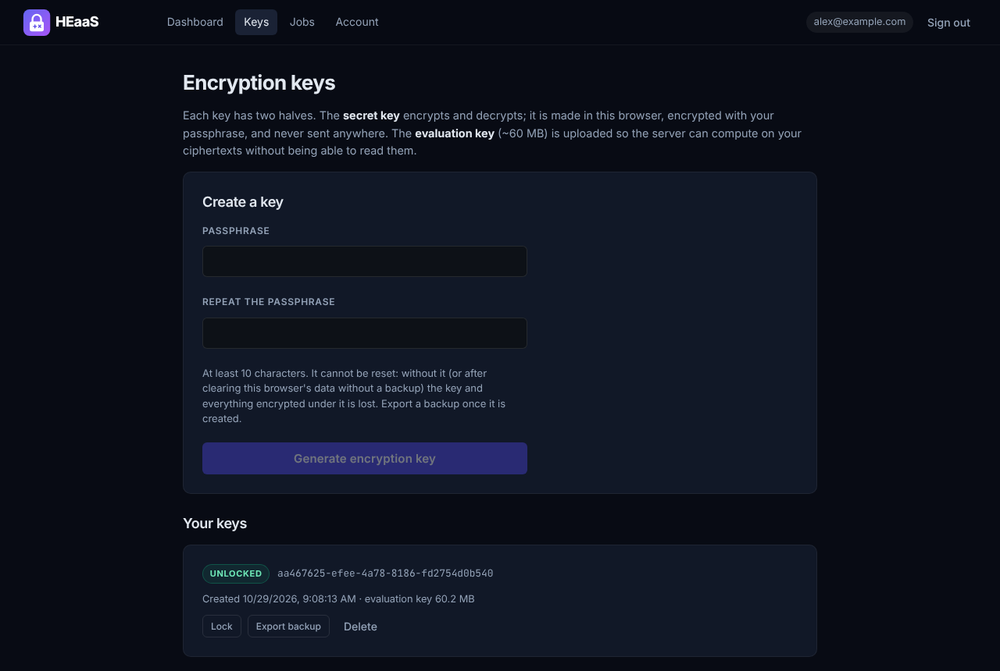
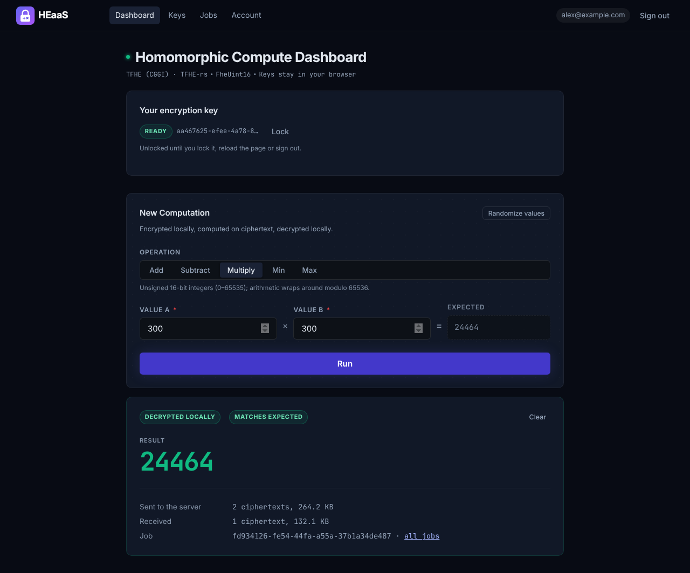

<p align="center"></p>

# HEaaS user guide

HEaaS lets you run arithmetic on numbers it never sees. Your device encrypts them, the
service computes on the encrypted values, and only your device can decrypt the result.

This guide covers the web dashboard and the API. For how the system works and what it
does and does not protect, see the [How HEaaS works](how-it-works.md#what-the-server-can-and-cannot-learn)
and [SECURITY.md](../SECURITY.md); the exact cryptographic parameters are in
[`parameters.md`](parameters.md).

---

## 1. Your keys

HEaaS uses two keys, both generated on your device:

| Key | Size | Where it lives | What it can do |
|---|---|---|---|
| **Client key** (secret) | ~31 KB | Only on your device (in the dashboard, this browser's storage, encrypted with your passphrase) | Encrypt and decrypt |
| **Server key** (evaluation key) | ~60 MB | Uploaded to HEaaS | Compute on your ciphertexts, but **not** decrypt them |

The service never receives your client key, so it cannot read your data.

**Your passphrase protects your client key.** In the dashboard the key is stored only
in the browser you generated it in, encrypted with a passphrase you choose. You enter
the passphrase once per tab to unlock the key. Nobody can reset a forgotten
passphrase, not even the operator.

**Back up your key.** On the **Keys** page, **Export backup** downloads the encrypted
key as a file. With that file and the passphrase you can **Import backup** in another
browser or after clearing this one. Without either, the key and everything encrypted
under it is lost.

Each account can register up to 2 server keys (the operator can change this).

## 2. Using the dashboard



1. **Create an account** and verify your email address through the link sent to you.
2. **Sign in.**
3. **Create a key.** On **Keys**, choose a passphrase (at least 10 characters), enter
   it twice and choose **Generate encryption key**. Your browser creates the key pair
   in a few seconds, then uploads the ~60 MB server key. Choose **Export backup** and
   keep the file somewhere safe. On the **Dashboard** the key now shows **Ready**.
   After a reload, enter the passphrase there to unlock it again.
4. **Compute.** Choose an operation, enter two whole numbers between 0 and 65535, and
   choose **Run**. The dashboard shows each step:
   - *Encrypting in your browser*
   - *Sending ciphertexts* (two encrypted values, ~260 KB in total)
   - *Server computing on encrypted data*
   - *Decrypting in your browser*
5. **Read the result.** The result is decrypted in your browser and compared with the
   value the dashboard expected. **Matches expected** confirms the round trip.



Operations: **Add**, **Subtract**, **Multiply**, **Min**, **Max**. Values are unsigned
16-bit integers, so add, subtract and multiply wrap around modulo 65536. For example,
300 × 300 = 90000, which wraps to 24464, and 3 − 10 wraps to 65529.

**Past jobs.** **Jobs** lists your computations, newest first. Completed results can
be decrypted there while their key is unlocked; finished jobs are deleted after a few
days.

**Keys from another browser.** The **Keys** page marks keys whose client key is not in
this browser as *Not in this browser*. Use **Import backup** with the exported file
and its passphrase, or delete the key if you need room for a new one.

## 3. Using the API

To encrypt on your own systems, use the Rust SDK or the `heaas` command-line tool.
They generate your keys locally and only ever send the evaluation key and
ciphertexts:

```sh
export HEAAS_URL=https://<your HEaaS site> HEAAS_EMAIL=you@example.com
heaas keygen         # heaas-client.key is your secret key: keep it (and a backup) safe
heaas upload-key     # prints the key id
heaas run --key-id <key id> --op multiply 300 300    # prints 24464
```

From other languages, call the HTTP API directly. [Using the API](api.md) covers
authentication, every endpoint, errors, quotas and full request examples.

## 4. Troubleshooting

| What you see | Why | What to do |
|---|---|---|
| "In-browser encryption needs a cross-origin isolated page" | The browser or the deployment does not allow `SharedArrayBuffer`, which TFHE's WebAssembly needs | Use a current Chrome, Edge, Firefox or Safari. Operators: serve the frontend with the COOP/COEP headers described in [Self-hosting](self-hosting.md#deployment) |
| `409` "You already have 2 server keys" | Your account has reached its key limit | Delete a key you no longer use |
| `400` "Not a compressed server key for this service's parameters" | The key was made with different parameters or a different TFHE-rs release | Generate it with TFHE-rs 1.8.2 and `ConfigBuilder::default()` |
| `413 Payload Too Large` | The upload is over the size limit | Upload only the compressed server key, never the full server key |
| Job `failed`: "Input 1 is not a valid FheUint16 ciphertext for this key" | The input is not an `FheUint16`, is corrupted, or was made with other parameters | Encrypt with the client key that belongs to `key_id` and `safe_serialize` the result |
| `404` "Server key not found" | The key id is wrong, deleted, or belongs to another account | List your keys with `GET /api/v1/keys` (or `heaas keys`) |
| `429` "Too many sign-in attempts for this account" | Several failed sign-ins in a short time | Wait the `Retry-After` seconds, or reset your password |
| Verification or reset link says "Invalid or expired" | Links work once; verification links last 24 hours and reset links 1 hour (unless the operator changed this; the email says how long) | Request a new one from the sign-in page |
| "For your security, sign in again" when deleting a Google/GitHub account | Deleting an account without a password needs a fresh sign-in | Sign out, sign in again, then delete within 5 minutes |
| `429` "Daily compute quota … reached" | You submitted the maximum number of jobs today | Wait until midnight UTC (`Retry-After` says how long) |
| `429` "You have N jobs waiting or running" | Too many of your jobs are unfinished | Wait for some to finish, then resubmit |
| `503` "The job queue is full" | The service is busy | Retry after the `Retry-After` seconds |
| `422` "This Idempotency-Key was already used for a different request" | You reused a key for a new request | Use a new key for each new job |
| `409` on `…/result` | The job has not completed | Poll the job until `status` is `completed` |
| Job `failed`: "Timed out after N seconds" | The computation took longer than the server allows | Contact the operator |
| The decrypted value is meaningless | You decrypted with a different client key than the one the inputs were encrypted with | Use the client key that matches the job's `key_id` |

## 5. FAQ

**Can HEaaS read my numbers?**
No. It has only your server key, which cannot decrypt. It does see metadata: when you
submit jobs, which operation each uses and how many you run.

**Can I check that the server computed correctly?**
Not cryptographically: TFHE does not prove correctness. The dashboard compares each
result with the value it expected, which catches errors for the values you test.

**What if I lose my client key or forget its passphrase?**
Import your backup file if you have one (it needs the same passphrase). Otherwise
nothing encrypted under the key can be decrypted any more, by you or anyone else.
Generate a new key; the old server key can be deleted.

**Which numbers are supported?**
Unsigned 16-bit integers (0–65535) with add, subtract, multiply (all mod 65536), min
and max.
